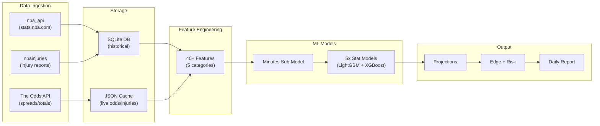

# NBA Betting Prediction System — Final Implementation Blueprint

> **Purpose**: This document is the complete, self-contained specification. Any developer or AI agent should be able to build the entire system from this document alone, without needing additional context.

---

## User Decisions (Locked In)

| Decision | Choice |
|---|---|
| Target stats | **All 5**: Points, Rebounds, Assists, 3-Pointers Made, combo PRA |
| Odds source | **Phase 1**: Game-level spreads/totals via The Odds API (free). **Phase 2**: Add player props via OddsPapi or manual input |
| Bet placement | **Manual only** (model outputs recommendations, user places bets on bet365.es / winamax.es) |
| Output language | English |
| Platform | Python 3.12, Windows 11 |
| Historical depth | 10 seasons (2014-15 through 2024-25) |
| Bookmakers | bet365.es, winamax.es (both legally licensed in Spain under DGOJ) |

---

## System Architecture



---

## Project Structure

```
c:\Users\ramir\Desktop\proyecto_ml\
│
├── config/
│   └── settings.yaml              # API keys, paths, model hyperparams
│
├── data/
│   ├── nba_stats.db               # SQLite database (all historical data)
│   ├── cache/                     # Live odds/injury JSON cache
│   └── models/                    # Saved model artifacts (.joblib)
│
├── src/
│   ├── __init__.py
│   │
│   ├── ingestion/
│   │   ├── __init__.py
│   │   ├── nba_stats.py           # Fetch player game logs, box scores, team stats
│   │   ├── injuries.py            # Fetch injury reports
│   │   ├── odds.py                # Fetch game-level odds from The Odds API
│   │   └── scheduler.py           # Orchestrate daily data refresh
│   │
│   ├── features/
│   │   ├── __init__.py
│   │   ├── rolling.py             # Rolling window stat calculations
│   │   ├── matchup.py             # Opponent defense features
│   │   ├── context.py             # Schedule, rest, home/away features
│   │   ├── market.py              # Vegas lines as features
│   │   └── builder.py             # Assemble full feature matrix
│   │
│   ├── models/
│   │   ├── __init__.py
│   │   ├── minutes_model.py       # Minutes prediction sub-model
│   │   ├── stat_model.py          # Per-stat prediction models
│   │   ├── ensemble.py            # Weighted ensemble logic
│   │   ├── train.py               # Full training pipeline
│   │   └── predict.py             # Inference pipeline
│   │
│   ├── betting/
│   │   ├── __init__.py
│   │   ├── edge.py                # Edge calculation
│   │   ├── risk.py                # Risk assessment scoring
│   │   ├── kelly.py               # Kelly Criterion stake sizing
│   │   └── report.py              # Daily bet report (HTML/console)
│   │
│   └── utils/
│       ├── __init__.py
│       ├── db.py                   # SQLite connection helpers
│       ├── constants.py            # Team IDs, position maps, season strings
│       └── logger.py              # Structured logging
│
├── notebooks/                     # Jupyter exploration notebooks
│
├── tests/
│   └── ...
│
├── requirements.txt
├── main.py                        # CLI entry point
└── README.md
```

---

## Dependencies (`requirements.txt`)

```
nba_api>=1.5.0
nbainjuries>=0.2.0
requests>=2.31.0
pandas>=2.1.0
numpy>=1.24.0
scikit-learn>=1.3.0
lightgbm>=4.0.0
xgboost>=2.0.0
optuna>=3.4.0
joblib>=1.3.0
pyarrow>=14.0.0
pyyaml>=6.0.0
schedule>=1.2.0
rich>=13.0.0
jinja2>=3.1.0
```

---

## Database Schema (SQLite)

### Table: `player_game_logs`
*Source: `nba_api` — `PlayerGameLogs` endpoint, one row per player per game*

```sql
CREATE TABLE IF NOT EXISTS player_game_logs (
    id INTEGER PRIMARY KEY AUTOINCREMENT,
    season TEXT NOT NULL,           -- '2024-25'
    game_id TEXT NOT NULL,          -- '0022400123'
    game_date DATE NOT NULL,
    player_id INTEGER NOT NULL,
    player_name TEXT NOT NULL,
    team_id INTEGER NOT NULL,
    team_abbr TEXT NOT NULL,
    opponent_team_id INTEGER NOT NULL,
    opponent_team_abbr TEXT NOT NULL,
    is_home INTEGER NOT NULL,       -- 1=home, 0=away
    wl TEXT,                        -- 'W' or 'L'
    minutes REAL,
    pts INTEGER,
    reb INTEGER,
    ast INTEGER,
    stl INTEGER,
    blk INTEGER,
    tov INTEGER,
    fg_made INTEGER,
    fg_attempted INTEGER,
    fg_pct REAL,
    fg3_made INTEGER,
    fg3_attempted INTEGER,
    fg3_pct REAL,
    ft_made INTEGER,
    ft_attempted INTEGER,
    ft_pct REAL,
    oreb INTEGER,
    dreb INTEGER,
    plus_minus REAL,
    started INTEGER,                -- 1=starter, 0=bench (derived from nba_api)
    UNIQUE(game_id, player_id)
);
CREATE INDEX idx_pgl_player_date ON player_game_logs(player_id, game_date);
CREATE INDEX idx_pgl_game ON player_game_logs(game_id);
CREATE INDEX idx_pgl_season ON player_game_logs(season);
```

### Table: `team_game_stats`
*Source: `nba_api` — `LeagueGameLog` or `BoxScoreTraditionalV3`*

```sql
CREATE TABLE IF NOT EXISTS team_game_stats (
    id INTEGER PRIMARY KEY AUTOINCREMENT,
    season TEXT NOT NULL,
    game_id TEXT NOT NULL,
    game_date DATE NOT NULL,
    team_id INTEGER NOT NULL,
    team_abbr TEXT NOT NULL,
    opponent_team_id INTEGER NOT NULL,
    is_home INTEGER NOT NULL,
    wl TEXT,
    pts INTEGER,
    opp_pts INTEGER,
    pace REAL,                      -- possessions per 48 min
    off_rating REAL,
    def_rating REAL,
    UNIQUE(game_id, team_id)
);
```

### Table: `injury_reports`
*Source: `nbainjuries` package + manual updates*

```sql
CREATE TABLE IF NOT EXISTS injury_reports (
    id INTEGER PRIMARY KEY AUTOINCREMENT,
    report_date DATE NOT NULL,
    player_id INTEGER,
    player_name TEXT NOT NULL,
    team_abbr TEXT NOT NULL,
    status TEXT NOT NULL,           -- 'Out', 'Doubtful', 'Questionable', 'Probable', 'Available'
    reason TEXT,                    -- 'Right Knee Soreness', etc.
    UNIQUE(report_date, player_name, team_abbr)
);
```

### Table: `game_odds`
*Source: The Odds API*

```sql
CREATE TABLE IF NOT EXISTS game_odds (
    id INTEGER PRIMARY KEY AUTOINCREMENT,
    game_id TEXT,                   -- NBA game ID (matched after game resolution)
    event_id TEXT NOT NULL,         -- Odds API event ID
    commence_time DATETIME NOT NULL,
    home_team TEXT NOT NULL,
    away_team TEXT NOT NULL,
    bookmaker TEXT NOT NULL,        -- 'bet365', 'pinnacle', etc.
    market TEXT NOT NULL,           -- 'spreads', 'totals', 'h2h'
    home_spread REAL,
    away_spread REAL,
    total_over REAL,
    total_under REAL,
    home_ml_price REAL,
    away_ml_price REAL,
    fetched_at DATETIME NOT NULL,
    UNIQUE(event_id, bookmaker, market, fetched_at)
);
```

### Table: `predictions`
*For tracking model accuracy*

```sql
CREATE TABLE IF NOT EXISTS predictions (
    id INTEGER PRIMARY KEY AUTOINCREMENT,
    game_id TEXT NOT NULL,
    game_date DATE NOT NULL,
    player_id INTEGER NOT NULL,
    player_name TEXT NOT NULL,
    stat_type TEXT NOT NULL,        -- 'PTS', 'REB', 'AST', '3PM', 'PRA'
    predicted_value REAL NOT NULL,
    actual_value REAL,              -- filled after game completes
    book_line REAL,                 -- the over/under line from bookmaker
    book_odds REAL,                 -- decimal odds
    edge REAL,                      -- predicted - book_line
    risk_level TEXT,                -- 'LOW', 'MEDIUM', 'HIGH'
    bet_placed INTEGER DEFAULT 0,
    bet_result TEXT,                -- 'WIN', 'LOSS', 'PUSH', NULL
    created_at DATETIME DEFAULT CURRENT_TIMESTAMP
);
```

---

## Feature Engineering Specifications

### Notation
- $S$ = stat (PTS, REB, AST, 3PM, MIN)
- $t$ = current game index (chronological)
- $n$ = window size

### Category 1: Rolling Player Performance

| Feature Name | Formula | Notes |
|---|---|---|
| `{S}_last_1` | $S_{t-1}$ | Most recent game |
| `{S}_roll_3` | $\frac{1}{3}\sum_{i=1}^{3} S_{t-i}$ | 3-game rolling mean |
| `{S}_roll_5` | $\frac{1}{5}\sum_{i=1}^{5} S_{t-i}$ | 5-game rolling mean |
| `{S}_roll_10` | $\frac{1}{10}\sum_{i=1}^{10} S_{t-i}$ | 10-game rolling mean |
| `{S}_roll_20` | $\frac{1}{20}\sum_{i=1}^{20} S_{t-i}$ | 20-game rolling mean |
| `{S}_season_avg` | $\frac{1}{N}\sum_{i=1}^{N} S_{t-i}$ where all are same season | Season-to-date |
| `{S}_ewma_10` | EWMA with span=10 | Recent-biased average |
| `{S}_std_10` | $\sigma(S_{t-1}, ..., S_{t-10})$ | Consistency measure |
| `{S}_trend_5` | Slope of OLS regression on $(1..5, S_{t-5..t-1})$ | Trending up/down |
| `{S}_pct_change_5` | $(S\_roll\_5 - S\_roll\_20) / S\_roll\_20$ | Relative form change |

**Apply for**: PTS, REB, AST, 3PM, MIN, FGA, FG_PCT, USG_PCT (where available)

### Category 2: Usage & Opportunity

| Feature Name | Source | Notes |
|---|---|---|
| `min_roll_5` | Rolling stats | Average minutes last 5 games |
| `min_share` | $\text{player\_min} / \text{team\_total\_min}$ | Share of team minutes |
| `is_starter` | 1 if `started=1` in last game | Binary |
| `starter_streak` | Consecutive games started | Integer |
| `usage_rate` | From advanced box score if available, else approximate | % of possessions used |
| `top_teammate_1_out` | 1 if team's #1 usage player is on injury report (Out/Doubtful) | Binary |
| `top_teammate_2_out` | Same for #2 usage player | Binary |
| `top_teammate_3_out` | Same for #3 usage player | Binary |
| `games_played_season` | Count of games played this season to date | Fitness/ramp-up proxy |

### Category 3: Matchup & Opponent

| Feature Name | Source | Notes |
|---|---|---|
| `opp_def_rating_10` | Opponent's defensive rating over last 10 games | Lower = better defense |
| `opp_pts_allowed_pos_10` | Opponent PTS allowed to player's position (PG/SG/SF/PF/C) last 10 games | Position-specific |
| `opp_reb_allowed_pos_10` | Same for rebounds | Position-specific |
| `opp_ast_allowed_pos_10` | Same for assists | Position-specific |
| `opp_3pm_allowed_10` | Opponent 3PM allowed per game last 10 | For 3PM model |
| `opp_pace_10` | Opponent pace last 10 games | More possessions = more stats |
| `opp_paint_pts_allowed_10` | Opponent points in paint allowed | For PTS/REB |
| `vs_opp_stat_avg` | Player's average stat vs. this specific opponent (last 5 meetings) | Historical matchup |

### Category 4: Schedule & Environment

| Feature Name | Derivation | Notes |
|---|---|---|
| `rest_days` | `game_date - prev_game_date` for player's team | 0 = back-to-back |
| `is_b2b` | `1 if rest_days == 0` | Binary |
| `is_home` | From game data | Binary |
| `road_trip_game` | Nth consecutive away game | Integer (0 if home) |
| `games_last_7d` | Count of team games in preceding 7 days | Schedule density |
| `is_denver` | 1 if game in Denver (altitude) | Binary |

### Category 5: Game Context (from Odds)

| Feature Name | Source | Notes |
|---|---|---|
| `implied_total` | Game over/under line | Higher = more scoring expected |
| `spread` | Point spread (negative = favored) | Game competitiveness |
| `abs_spread` | Absolute value of spread | Blowout magnitude |
| `is_big_favorite` | `1 if spread < -10` | Blowout risk (starters sit) |
| `is_big_underdog` | `1 if spread > 10` | Blowout risk (starters sit) |
| `implied_win_prob` | Derived from moneyline odds | Team strength signal |

> [!IMPORTANT]
> **Temporal Integrity Rule**: Every feature for game $t$ must be computed using ONLY data from games $< t$. Never include game $t$ data in its own features. This prevents data leakage and is the single most common mistake in sports ML.

---

## Model Training Configuration

### Minutes Sub-Model

```yaml
target: minutes_played
features: all Category 1 (for MIN only), Category 2, Category 3, Category 4, Category 5
algorithm: LightGBM Regressor
hyperparameters:
  num_leaves: 31
  max_depth: 6
  learning_rate: 0.05
  n_estimators: 500
  min_child_samples: 20
  subsample: 0.8
  colsample_bytree: 0.8
  reg_alpha: 0.1
  reg_lambda: 1.0
  early_stopping_rounds: 50
validation: TimeSeriesSplit (5 folds, expanding window)
metric: MAE (Mean Absolute Error)
```

### Per-Stat Models (x5: PTS, REB, AST, 3PM, PRA)

```yaml
target: [pts, reb, ast, fg3_made, pts+reb+ast]
features: all Category 1-5 + predicted_minutes from sub-model
algorithms:
  model_a:
    type: LightGBM Regressor
    weight: 0.55
    hyperparameters:
      num_leaves: 63
      max_depth: 7
      learning_rate: 0.03
      n_estimators: 800
      min_child_samples: 15
      subsample: 0.8
      colsample_bytree: 0.75
      reg_alpha: 0.1
      reg_lambda: 1.0
      early_stopping_rounds: 50
  model_b:
    type: XGBoost Regressor
    weight: 0.45
    hyperparameters:
      max_depth: 6
      learning_rate: 0.03
      n_estimators: 800
      min_child_weight: 10
      subsample: 0.8
      colsample_bytree: 0.75
      reg_alpha: 0.1
      reg_lambda: 1.0
      early_stopping_rounds: 50

ensemble_prediction: 0.55 * lgbm_pred + 0.45 * xgb_pred

validation:
  method: Walk-Forward (Time-Series Split)
  train_seasons: 2014-15 through 2021-22 (8 seasons)
  validation_season: 2022-23
  test_season: 2023-24
  live_season: 2024-25+

metrics:
  primary: MAE
  secondary: [RMSE, R², within_5%_accuracy]

hyperparameter_tuning:
  tool: Optuna
  n_trials: 100
  sampler: TPE
  cv: TimeSeriesSplit(n_splits=5)

retraining_schedule: Weekly (every Monday during NBA season)
```

---

## Edge Calculation

### Step 1: Convert Book Line to Probability

For an over/under player prop line $L$ with your model's projection $P$:

$$\text{edge} = P - L$$

If $\text{edge} > 0$: bet the **Over**
If $\text{edge} < 0$: bet the **Under** (edge magnitude = $|P - L|$)

### Step 2: Estimate Win Probability (from projection distribution)

Assuming player stat follows approximately normal distribution around the model's projection:

$$P(\text{Over } L) = 1 - \Phi\left(\frac{L - P}{\sigma_{\text{model}}}\right)$$

Where $\sigma_{\text{model}}$ is the model's standard deviation of errors from validation.

### Step 3: Calculate Expected Value

$$\text{EV} = (P_{\text{win}} \times \text{profit\_if\_win}) - (P_{\text{loss}} \times \text{stake})$$

At standard -110 odds (1.91 decimal):

$$\text{EV} = (P_{\text{win}} \times 0.91) - ((1 - P_{\text{win}}) \times 1.0)$$

Only bet when $\text{EV} > 0$, i.e., $P_{\text{win}} > 52.4\%$

### Step 4: Kelly Criterion Stake Sizing

$$f^* = \frac{bp - q}{b}$$

Where:
- $f^*$ = fraction of bankroll to wager
- $b$ = decimal odds - 1 (e.g., 0.91 for -110)
- $p$ = estimated win probability
- $q$ = $1 - p$

**Use fractional Kelly (25%)** to reduce variance: $\text{stake} = 0.25 \times f^* \times \text{bankroll}$

---

## Risk Assessment Algorithm

```python
def calculate_risk_score(game_context: dict) -> tuple[str, float]:
    """
    Returns (risk_level, risk_score) where:
    - risk_level: 'LOW', 'MEDIUM', 'HIGH'
    - risk_score: float 0-10
    """
    score = 0.0

    # Factor 1: Blowout potential (weight: 2.0)
    abs_spread = abs(game_context['spread'])
    if abs_spread > 12:
        score += 2.0    # HIGH: starters likely sit 4th quarter
    elif abs_spread > 8:
        score += 1.2    # MEDIUM
    elif abs_spread > 5:
        score += 0.6    # LOW-MEDIUM
    # else: 0 (competitive game, full minutes expected)

    # Factor 2: Player injury/availability status (weight: 2.0)
    status = game_context['player_status']  # 'Available', 'Probable', 'Questionable', 'GTD'
    if status in ('Questionable', 'GTD'):
        score += 2.0    # HIGH: may not play or be minute-limited
    elif status == 'Probable':
        score += 0.5
    # Available = 0

    # Factor 3: Minutes consistency (weight: 1.5)
    min_std = game_context['minutes_std_10']
    if min_std > 6:
        score += 1.5    # HIGH: wildly inconsistent minutes
    elif min_std > 3:
        score += 0.75
    # else: 0

    # Factor 4: Stat consistency (weight: 1.5)
    stat_cv = game_context['stat_std_10'] / max(game_context['stat_roll_10'], 0.1)
    if stat_cv > 0.4:
        score += 1.5    # HIGH: very inconsistent performer
    elif stat_cv > 0.2:
        score += 0.75
    # else: 0

    # Factor 5: Back-to-back (weight: 1.0)
    if game_context['is_second_of_b2b']:
        score += 1.0    # Known minutes/performance drop
    elif game_context['is_first_of_b2b']:
        score += 0.3

    # Factor 6: Model edge magnitude (weight: 1.0, inverse)
    edge_pct = abs(game_context['edge']) / max(game_context['book_line'], 0.1)
    if edge_pct < 0.05:
        score += 1.0    # Tiny edge, high risk of being wrong
    elif edge_pct < 0.10:
        score += 0.5

    # Factor 7: Key teammate availability (weight: 0.5)
    teammates_out = game_context['key_teammates_out']
    if teammates_out >= 2:
        score += 0.5    # Usage patterns become unpredictable
    elif teammates_out == 1:
        score += 0.25

    # Factor 8: First matchup / roster changes (weight: 0.5)
    if game_context['times_played_opp_this_season'] == 0:
        score += 0.5
    if game_context['opponent_recent_trade']:
        score += 0.25

    # Classification
    if score <= 2.5:
        return ('LOW', score)
    elif score <= 5.0:
        return ('MEDIUM', score)
    else:
        return ('HIGH', score)
```

---

## Implementation Order (Step by Step)

### Phase 1: Data Foundation
1. `pip install` all dependencies
2. Create project directory structure
3. Implement `src/utils/db.py` — SQLite connection, table creation
4. Implement `src/utils/constants.py` — season strings, team abbreviation maps
5. Implement `src/ingestion/nba_stats.py`:
   - Function: `fetch_all_player_game_logs(seasons: list[str])` using `PlayerGameLogs` endpoint
   - Function: `fetch_team_game_stats(seasons: list[str])`
   - Respect 1-second delay between API calls
   - Store into SQLite tables
   - **Expected**: ~500K+ rows for 10 seasons of player game logs
6. Implement `src/ingestion/injuries.py`:
   - Function: `fetch_current_injuries()` using `nbainjuries` package
   - Store into `injury_reports` table
7. Implement `src/ingestion/odds.py`:
   - Function: `fetch_nba_odds(api_key)` using The Odds API
   - Markets: `spreads`, `totals`, `h2h`
   - Regions: `eu,us`
   - Store into `game_odds` table

### Phase 2: Feature Engineering
8. Implement `src/features/rolling.py`:
   - Function: `compute_rolling_features(df, stat_cols, windows=[3,5,10,20])`
   - Must sort by `(player_id, game_date)` and use `.shift(1)` to prevent leakage
   - Compute EWMA, std, trend for each stat
9. Implement `src/features/matchup.py`:
   - Function: `compute_matchup_features(player_logs, team_stats)`
   - Opponent defense vs position requires mapping player positions
10. Implement `src/features/context.py`:
    - Function: `compute_context_features(player_logs)`
    - Rest days, B2B, home/away, road trip length
11. Implement `src/features/market.py`:
    - Function: `merge_odds_features(feature_df, odds_df)`
    - Match odds to games by date + team
12. Implement `src/features/builder.py`:
    - Function: `build_feature_matrix(season_range)` — calls all above and merges

### Phase 3: Model Training
13. Implement `src/models/minutes_model.py`:
    - Train LightGBM on minutes prediction
    - Save model artifact to `data/models/minutes_lgbm.joblib`
14. Implement `src/models/stat_model.py`:
    - Train LightGBM + XGBoost per stat target
    - Walk-forward validation
    - Save model artifacts
15. Implement `src/models/ensemble.py`:
    - Weighted average of LightGBM (0.55) + XGBoost (0.45)
16. Implement `src/models/train.py`:
    - Full pipeline: load data → build features → train minutes model → train stat models → evaluate → save
17. Implement `src/models/predict.py`:
    - Function: `predict_player_stats(player_id, game_date, opponent)` → dict of projected stats

### Phase 4: Betting Logic
18. Implement `src/betting/edge.py`:
    - Function: `calculate_edge(projection, book_line, book_odds)`
19. Implement `src/betting/risk.py`:
    - The risk scoring algorithm defined above
20. Implement `src/betting/kelly.py`:
    - Function: `kelly_stake(win_prob, decimal_odds, bankroll, fraction=0.25)`
21. Implement `src/betting/report.py`:
    - Function: `generate_daily_report(date)` → formatted console output + HTML file

### Phase 5: Orchestration
22. Implement `main.py`:
    - CLI commands: `ingest`, `train`, `predict`, `report`
    - `python main.py ingest --seasons 2014-15,2024-25`
    - `python main.py train`
    - `python main.py report --date 2025-01-15`
23. Implement `src/ingestion/scheduler.py`:
    - Daily automated data refresh (using `schedule` library)
    - Run at 10:00 AM local time on game days

---

## API Keys Required

| Service | Key Location | Cost | How to Get |
|---|---|---|---|
| The Odds API | `config/settings.yaml` → `odds_api_key` | Free (500 credits/mo) or \$30/mo | https://the-odds-api.com → Sign up |
| nba_api | None needed | Free | `pip install nba_api` |
| nbainjuries | None needed | Free | `pip install nbainjuries` |

---

## Config File Template (`config/settings.yaml`)

```yaml
# API Configuration
odds_api:
  api_key: "YOUR_ODDS_API_KEY_HERE"
  base_url: "https://api.the-odds-api.com/v4"
  regions: "eu,us"
  markets: "spreads,totals,h2h"
  sport: "basketball_nba"

# Database
database:
  path: "data/nba_stats.db"

# Model
model:
  artifacts_dir: "data/models"
  retrain_day: "Monday"
  seasons_train: ["2014-15", "2015-16", "2016-17", "2017-18", "2018-19",
                   "2019-20", "2020-21", "2021-22"]
  season_validate: "2022-23"
  season_test: "2023-24"
  season_live: "2024-25"
  lgbm_weight: 0.55
  xgb_weight: 0.45
  optuna_trials: 100

# Betting
betting:
  bankroll: 1000.0          # Starting bankroll in EUR
  kelly_fraction: 0.25      # Use 25% Kelly
  min_edge_pct: 0.03        # Minimum 3% edge to recommend a bet
  max_risk_level: "HIGH"    # Show all bets (filter in report)

# Stats to model
target_stats:
  - pts
  - reb
  - ast
  - fg3_made
  - pra                     # pts + reb + ast combo

# Feature windows
feature_windows: [3, 5, 10, 20]
ewma_span: 10
```

---

## Validation Metrics to Track

| Metric | Target | Description |
|---|---|---|
| MAE (Mean Absolute Error) | < 4.0 for PTS, < 2.0 for REB/AST | Average prediction error |
| RMSE | Lower than simple season average baseline | Root mean squared error |
| Directional Accuracy | > 55% | % of times model correctly predicts Over vs Under |
| Closing Line Value (CLV) | Positive average | Does model beat closing lines? (most important metric for long-term profitability) |
| ROI (Return on Investment) | > 0% | Net profit / total wagered |
| Hit Rate | > 52.4% at -110 | Win percentage needed to break even at standard juice |

---

## Honest Limitations & Mitigations

| Limitation | Impact | Mitigation |
|---|---|---|
| No automated player props from EU bookmakers | Must manually input lines for player props initially | Phase 2: add OddsPapi or manual input workflow |
| nba_api rate limits | Bulk ingestion of 10 years takes ~2-4 hours | One-time cost; incremental updates are fast |
| Injury news can break after projections run | Outdated projections → bad bets | Re-run predictions 1-2 hours before tipoff |
| Model can't capture intangibles (motivation, rivalries) | Missed context | Risk score accounts for this via matchup factors |
| Bet365 limits winning accounts | Reduced bet sizes over time | Diversify across bet365 + Winamax; keep early stakes small |
| Model needs minimum ~20 games of data per player | Can't project rookies or new acquisitions accurately | Flag these as HIGH risk; require larger edge |
| Trades mid-season change usage patterns | Model trained on old team data | Retrain weekly; flag recently traded players as HIGH risk |

---

> [!NOTE]
> **To execute this plan**: Open a new conversation (to get fresh token budget), paste the path to this file, and say "Build Phase 1 of the NBA betting system following the blueprint at `c:\Users\ramir\Desktop\proyecto_ml\nba_betting_plan.md`". The plan is self-contained — no additional context needed.
